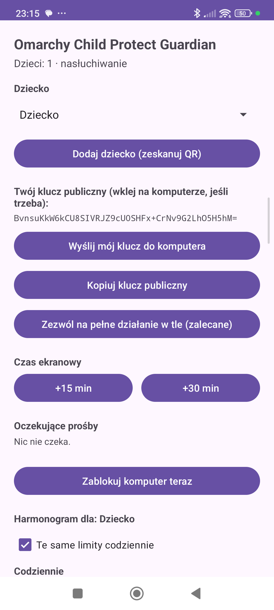

# Omarchy Child Protect Guardian 🛡️

**🌐 Languages:** **English** · [Polski](README.pl.md) · [Español](README.es.md) · [Deutsch](README.de.md) · [Français](README.fr.md) · [中文](README.zh.md)

> Parental controls & online child safety for **Omarchy Linux** (Arch + Hyprland),
> with **remote approval of app installs** from the parent's phone — a push-approval
> flow just like confirming a 2FA login.

> **Privacy caveat:** using the **public** `ntfy.sh` broker sends install requests (and, if enabled,
> audit entries) through a third party — signed, but **not encrypted**. For real privacy run a
> **self-hosted ntfy with auth/ACLs**; payload encryption to the parent key is planned.

Ambitious goal: be **more convenient and more effective** than Microsoft Family Safety,
Apple Screen Time, Google Family Link and Qustodio — while staying **private** (no telemetry,
no shipping your child's data to a corporate cloud).

---

## 🚀 Install & update

> **Full, security-ordered deploy guide:** **[`packaging/README.md`](packaging/README.md)** (hardware
> baseline → daemon → pacman hook → nftables egress → fapolicyd → hardening → updating). Short version:

**On the child's computer (Arch / Omarchy):**
```bash
git clone https://github.com/wasyleque/omarchy-child-protect-guardian
cd omarchy-child-protect-guardian/daemon && cargo build --release && cd ..
sudo packaging/install.sh                   # safe default (only 'pacman -S sl' gated); add --enforce when ready
sudo packaging/setup-child.sh <child-name>  # locked-down child account (no sudo) + pairing QR
```
Then apply the host-specific layers — **nftables** egress, the **fapolicyd** execution allowlist
(`guardian-fapolicyd-setup.sh`, *required* for real enforcement), browser/NM lockdown and the hardware
baseline — all in [`packaging/README.md`](packaging/README.md). Check it end to end anytime with
`sudo packaging/smoke-test.sh <child>`.

**On the parent's phone:** install the Android app from the
**[Releases page](https://github.com/wasyleque/omarchy-child-protect-guardian/releases/latest)** and
scan the pairing QR — details in [📱 Android parent app](#-android-parent-app).

**Updating later:** `git pull` → `cargo build --release` → `sudo packaging/install.sh` →
`sudo systemctl restart guardiand` (under fapolicyd enforcing, re-trust the new binaries first) — full
steps in [`packaging/README.md` → *7. Updating*](packaging/README.md#7-updating-to-a-new-version). The
phone's APK installs **in place** over the old one (pairing kept, no re-pair).

---

## Why Linux/Omarchy wins here

Things competitors on Windows/macOS/Android **can't** do, but we can:

1. **Zero-Bypass (genuinely tamper-proof).** On Windows/macOS kids kill the process in the task
   manager or reset permissions. Here the daemon is protected by Polkit, the child has no `sudo`,
   and cgroups v2 make it unkillable. Network filtering happens in the kernel (`nftables`/eBPF),
   so free VPNs, proxies and Tor don't slip past the policy.
2. **Compositor-level control (Hyprland/Wayland).** We can *freeze* a process (`SIGSTOP`),
   blur an unauthorized window, block screen capture/sharing — with no invasive browser extensions.
3. **Zero overhead, 100% privacy.** No bloatware, no telemetry; policies run locally and offline.
   The cloud is used **only** to relay the parent's decision.
4. **System-wide filtering, not per-browser.** One DNS/network policy covers every app
   (games, launchers, messengers), not just Chrome.

## Product pillars

- **Remote install approval** — a `pacman`/`yay`/`flatpak` attempt is held; the parent gets a push
  with a human-readable description of the app and taps *Allow / Deny*.
- **Time budget & schedule** — enforced hard via cgroups freeze + Hyprland idle.
- **System-wide content filter** — DNS + eBPF, enforced SafeSearch / restricted mode.
- **Readable reports for the parent** — what the child did and asked for (no creepy corporate spying).
- **Cryptographically signed approvals** — even a compromised push broker can't forge an "Allow".
- **Scoped remote-root (Intent Binding)** — an approval grants root for *exactly one* described
  action, never a shell; cryptographically bound to what the parent actually saw.
- **AI risk assistant** — on-demand, plain-language risk check (traffic light + permission
  translator); public app metadata only, zero child data leaves the device.
- **LACS open age ratings** — a community, multi-dimensional age scale beyond PEGI/ESRB, covering
  Linux/AUR/Flathub apps.
- **Gentle stats & AI parenting digest** — hours, apps and site categories, plus a weekly summary
  that coaches the parent toward a conversation — not a surveillance dossier.

## Documentation

| Document | Contents |
|---|---|
| [`docs/CONCEPT.en.md`](docs/CONCEPT.en.md) / [`docs/KONCEPCJA.md`](docs/KONCEPCJA.md) | Full concept, advantages, use cases, non-obvious ideas |
| [`docs/ARCHITECTURE.en.md`](docs/ARCHITECTURE.en.md) / [`docs/ARCHITEKTURA.md`](docs/ARCHITEKTURA.md) | Architecture: daemon, interception points, push-approval, security |
| [`docs/ROADMAP.md`](docs/ROADMAP.md) | Build stages (MVP → v1), split into small verifiable steps |
| [`docs/THREAT_MODEL.md`](docs/THREAT_MODEL.md) | Anti-bypass design: adversary tiers, every bypass vector → its mitigation, honest limits |
| [`docs/REVIEW-RESPONSE.md`](docs/REVIEW-RESPONSE.md) · [`docs/REVIEW-RESPONSE-2.md`](docs/REVIEW-RESPONSE-2.md) | Responses to the two external security reviews (each finding → fix/status) |
| [`android-app/`](android-app/) | **Native Android parent app** (Kotlin) — the recommended parent client; on-device Ed25519 signing, background push |
| [`parent-app/`](parent-app/) | Cross-platform parent approval app (installable PWA) — on-device Ed25519 signing |
| [`packaging/`](packaging/) | Deploy: installer, systemd unit, pacman hook, nftables egress, fapolicyd allowlist, hardening audit |
| [`docs/TESTING.md`](docs/TESTING.md) | Step-by-step test plan for a clean system (layer-by-layer + red-team bypass attempts) |

## 📱 Android parent app

The recommended parent client is a **native Android app** (Kotlin) — download it from the
**[Releases page](https://github.com/wasyleque/omarchy-child-protect-guardian/releases/latest)** and
pair it by scanning a QR code. Interface in **English · Polski · Español** (follows the phone's language).

<p align="center">
  
</p>

What it does:

- **Approve or deny installs** — when the child runs `pacman`/`yay`/`flatpak`/`snap`/`nix`, the attempt
  is held and you get a push with the app name, the exact command, and a 🟢/🟡/🔴 **AI risk light**;
  tap **Allow / Deny** from the notification *or* from the in-app list. Every decision is signed
  on-device, so even a compromised push broker can't forge an "Allow".
- **Several children, one phone** — add each child (own computer or a shared PC) and switch between
  them; each request/notification is tagged with the child's name.
- **Screen-time schedule, no typing** — set a daily limit from a dropdown and allowed hours with a
  time picker, the same for every day or per weekday. Pushed to the computer cryptographically signed.
- **Instant lock** — lock the child's computer right now (and unlock) from the phone.
- **Extra time** — grant a specific child +15 / +30 minutes with one tap.
- **Daily AI digest** — an optional once-a-day summary of what was used, whether the child tried
  something they shouldn't, and a clear warning if worrying topics (drugs, self-harm, weapons…) showed
  up — generated by a **local** model on your own machine, so nothing leaves your network.

## Status

✅ **Working — in active testing, not yet a child's sole protection.** The core is built and
unit/e2e-tested, runs on real hardware (the push-approval loop, screen-time, fapolicyd, nftables and
the audit chain all behave as designed), and the native Android app is installed and working. Two
external security reviews (2026-10-09, 2026-10-14) and three on-host hardware tests
(2026-10-21/23) drove fixes for real enforcement bugs. **Until the full hardware baseline + fapolicyd
enforcing are set up and verified on your machine, treat it as a strong assist, not the only line of
defence.** See the reviews
[`guardian-security-review.md`](guardian-security-review.md) + [`guardian-security-review-2.md`](guardian-security-review-2.md),
the responses [`docs/REVIEW-RESPONSE.md`](docs/REVIEW-RESPONSE.md) + [`docs/REVIEW-RESPONSE-2.md`](docs/REVIEW-RESPONSE-2.md),
and the on-host reports [`guardian-test-report-2026-10-21.md`](guardian-test-report-2026-10-21.md) +
[`guardian-test-report-2026-10-23.md`](guardian-test-report-2026-10-23.md). Deploy per [`docs/TESTING.md`](docs/TESTING.md).

## How it's built (workflow)

Multi-agent workflow on this machine: **logic/architecture/integrations → `agy`**,
**simple implementation tasks → local Ollama (`qwen3-coder:30b`) via `aider`**.
`AGENTS.md` acts as the status file.

---

## 👤 Author

**Created by [wasyleque](https://github.com/wasyleque).**

## ❤️ Support the project

If Omarchy Child Protect Guardian is useful to you, you can support its development via **PayPal**:
**[wasyl@o2.pl](https://www.paypal.com/donate/?business=wasyl@o2.pl&item_name=Omarchy+Child+Protect+Guardian)**

Every bit helps keep this free, private and open.

## 🤝 Contribute & share ideas

This project grows on community ideas. **We warmly welcome you to:**
- 💡 **share ideas** — open an [Issue](../../issues) with the `idea` label (we have a template),
- 🛠️ **co-create features** — pick something from the [Roadmap](docs/ROADMAP.md), open a PR,
- 🌍 **translate the docs** into more languages.

See [`CONTRIBUTING.md`](CONTRIBUTING.md). No idea is too small — let's build the best parental-safety
tool on any platform, together.

## License

TBD (proposal: GPL-3.0 — a security tool whose value comes from being open and auditable).
